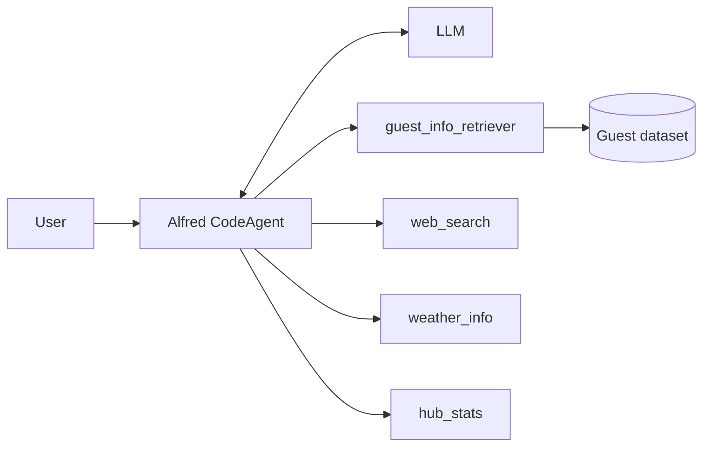

# Alfred, the Gala Agent

This is a simple school project for **CS4800-60**. It follows [Hugging Face Agents Course, Unit 3 (Agentic RAG)](https://huggingface.co/learn/agents-course/unit3/agentic-rag/introduction).

Alfred is an AI butler who helps host a gala. He is a [smolagents](https://github.com/huggingface/smolagents) `CodeAgent` that decides for himself which tools to use:

| Tool | What it does |
|---|---|
| `guest_info_retriever` | Searches the private guest list with BM25 (the RAG part) |
| `web_search` | Searches the web with DuckDuckGo |
| `weather_info` | Returns fake weather for a city (no real API) |
| `hub_stats` | Finds an organization's most downloaded model on the Hugging Face Hub |

## How it works



The LLM writes short Python code that calls the tools. smolagents runs that code and sends the results back to the LLM. This repeats until the LLM gives a final answer.

| File | Purpose |
|---|---|
| `retriever.py` | Loads the `agents-course/unit3-invitees` dataset and builds the guest search tool |
| `tools.py` | The web search, weather and Hub stats tools |
| `agent.py` | Builds Alfred; also runs one question from the command line |
| `app.py` | Chat interface in the browser (Gradio) |
| `notebook.ipynb` | Step-by-step walkthrough |

## Setup

These steps are for Windows. You need Python 3.12 or newer.

```powershell
git clone https://github.com/JhulianiH/alfred-gala-agent.git
cd alfred-gala-agent
python -m venv .venv
.\.venv\Scripts\Activate.ps1
pip install -r requirements.txt
copy .env.example .env
```

Then edit `.env` and pick a model backend:

- **Hugging Face** (`ALFRED_BACKEND=hf`): set `HF_TOKEN` to a token from https://huggingface.co/settings/tokens. This uses your Hugging Face credits.
- **Local Ollama** (`ALFRED_BACKEND=ollama`): free. Install [Ollama](https://ollama.com), then run `ollama pull qwen2.5-coder:7b`.

## Running

```powershell
python agent.py "Tell me about our guest named Lady Ada Lovelace."   # one question
python app.py                                                       # chat UI at http://127.0.0.1:7860
```

You can also open `notebook.ipynb` in VS Code with the `.venv` kernel.

## Test results

These are real runs from October 14, 2026, using the local `qwen2.5-coder:7b` model. All four queries called the expected tools. Because the model is not deterministic, answers will vary between runs.

**1. "Tell me about our guest named Lady Ada Lovelace."**
Tools used: `guest_info_retriever`
> Madam Ada Lovelace was a renowned and esteemed mathematician. She was a key figure in early computing, and is celebrated as the first computer programmer.

**2. "What's the weather like in Paris tonight? Will it be suitable for our fireworks display?"**
Tools used: `weather_info`
> The weather in Paris tonight is unsuitable for the fireworks display due to strong winds. We recommend rescheduling.

**3. "One of our guests is from Qwen. What can you tell me about their most popular model?"**
Tools used: `hub_stats`
> Qwen's most popular model is Qwen3-0.6B, with 30,452,693 downloads.

**4. "I need to speak with Dr. Nikola Tesla about recent advancements in wireless energy. Can you help me prepare for this conversation?"**
Tools used: `guest_info_retriever`, `web_search` (excerpt from a longer answer)
> Dr. Tesla, the key findings include significant improvements in transmission efficiency, scalable wireless networks using advanced antennas, and more efficient RF harvesting. [...] Dr. Tesla, the most transformative advancement is likely the breakthrough in wireless technology that uses light instead of radio waves.

## Notes

- The weather is fake. The same city always gets the same weather.
- DuckDuckGo search can be rate-limited. If that happens, the tool tells Alfred instead of crashing; just run the query again. No rate limits happened during the test runs.
- Small local models make more mistakes than large ones. To help them, the instructions in `agent.py` list the exact way to call each tool.
