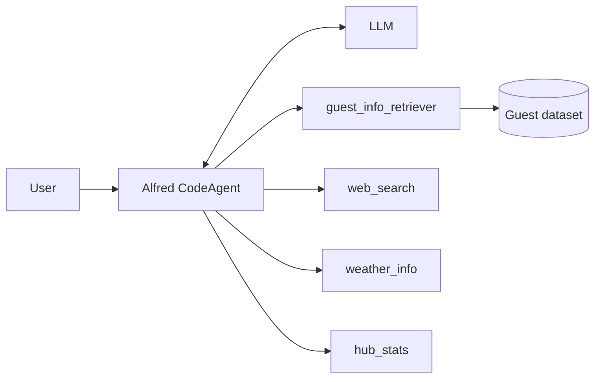
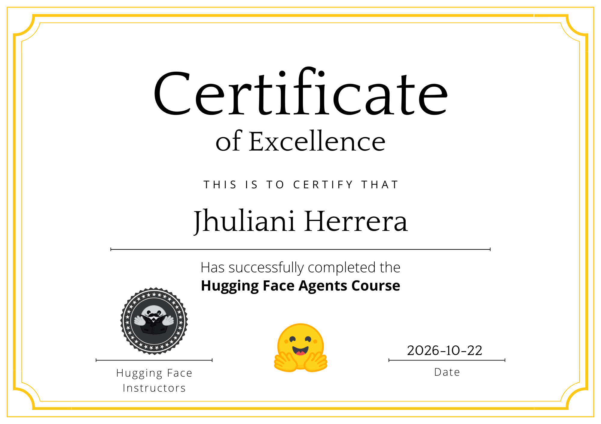

# Alfred, the Gala Agent

This is a simple school project for **CS4800-60**. It follows [Hugging Face Agents Course, Unit 3 (Agentic RAG)](https://huggingface.co/learn/agents-course/unit3/agentic-rag/introduction).

Alfred is an AI butler who helps host a gala. He is a [smolagents](https://github.com/huggingface/smolagents) `CodeAgent` that decides for himself which tools to use:

| Tool | What it does |
|---|---|
| `guest_info_retriever` | Searches the private guest list with BM25 (the RAG part) |
| `web_search` | Searches the web with DuckDuckGo |
| `weather_info` | Returns fake weather for a city (no real API) |
| `hub_stats` | Finds an organization's most downloaded model on the Hugging Face Hub |

## How it works



The LLM writes short Python code that calls the tools. smolagents runs that code and sends the results back to the LLM. This repeats until the LLM gives a final answer.

| File | Purpose |
|---|---|
| `retriever.py` | Loads the `agents-course/unit3-invitees` dataset and builds the guest search tool |
| `tools.py` | The web search, weather and Hub stats tools |
| `agent.py` | Builds Alfred; also runs one question from the command line |
| `app.py` | Chat interface in the browser (Gradio) |
| `notebook.ipynb` | Step-by-step walkthrough |
| `gaia.py` | Runs Alfred on the Unit 4 GAIA benchmark and submits his answers |
| `gaia_tools.py` | The web page, YouTube and attachment tools Alfred uses for GAIA |
| `Modelfile` | Ollama alias of `qwen3:8b` with a bigger context window, for GAIA |

## Setup

These steps are for Windows. You need Python 3.12 or newer.

```powershell
git clone https://github.com/Jhuliani-H/alfred-gala-agent.git
cd alfred-gala-agent
python -m venv .venv
.\.venv\Scripts\Activate.ps1
pip install -r requirements.txt
copy .env.example .env
```

Then edit `.env` and pick a model backend:

- **Hugging Face** (`ALFRED_BACKEND=hf`): set `HF_TOKEN` to a token from https://huggingface.co/settings/tokens. This uses your Hugging Face credits.
- **Local Ollama** (`ALFRED_BACKEND=ollama`): free. Install [Ollama](https://ollama.com), then run `ollama pull qwen2.5-coder:7b`.

## Running

```powershell
python agent.py "Tell me about our guest named Lady Ada Lovelace."   # one question
python app.py                                                       # chat UI at http://127.0.0.1:7860
```

You can also open `notebook.ipynb` in VS Code with the `.venv` kernel.

## Test results

These are real runs from October 14, 2026, using the local `qwen2.5-coder:7b` model. All four queries called the expected tools. Because the model is not deterministic, answers will vary between runs.

**1. "Tell me about our guest named Lady Ada Lovelace."**
Tools used: `guest_info_retriever`
> Madam Ada Lovelace was a renowned and esteemed mathematician. She was a key figure in early computing, and is celebrated as the first computer programmer.

**2. "What's the weather like in Paris tonight? Will it be suitable for our fireworks display?"**
Tools used: `weather_info`
> The weather in Paris tonight is unsuitable for the fireworks display due to strong winds. We recommend rescheduling.

**3. "One of our guests is from Qwen. What can you tell me about their most popular model?"**
Tools used: `hub_stats`
> Qwen's most popular model is Qwen3-0.6B, with 30,452,693 downloads.

**4. "I need to speak with Dr. Nikola Tesla about recent advancements in wireless energy. Can you help me prepare for this conversation?"**
Tools used: `guest_info_retriever`, `web_search` (excerpt from a longer answer)
> Dr. Tesla, the key findings include significant improvements in transmission efficiency, scalable wireless networks using advanced antennas, and more efficient RF harvesting. [...] Dr. Tesla, the most transformative advancement is likely the breakthrough in wireless technology that uses light instead of radio waves.

## GAIA benchmark (Unit 4)

For the [Unit 4 final assignment](https://huggingface.co/learn/agents-course/unit4/hands-on), `gaia.py` runs Alfred on the course's 20 level-1 [GAIA](https://huggingface.co/papers/2311.12983) questions and submits his answers. The course API grades by exact match (ignoring case), and 30% (6 of 20) passes.

For GAIA, Alfred swaps his gala tools for research tools:

| Tool | What it does |
|---|---|
| `web_search` | DuckDuckGo search (the same tool as the gala agent) |
| `visit_webpage` | Reads a web page as markdown. `focus` keywords return only the matching sections (with their tables) of long pages like Wikipedia |
| `youtube_transcript` | The spoken words of a YouTube video |

`gaia.py` also:

- pastes attached files into the question: Excel and CSV as tables, code and text as they are, MP3 transcribed with faster-whisper. Images can't be read, because the model has no vision.
- adds exact-match answer rules to every question.
- rejects a final answer written in the same step as a tool call whose output Alfred hasn't read yet. Small models often answer before looking.
- makes one extra LLM call that fixes the answer's format, not its content. For example, it changes `St. Petersburg` to `Saint Petersburg` when the question says "without abbreviations".

### GAIA setup

Ollama serves models with a 4096-token context by default, and the CodeAgent's system prompt nearly fills that on its own. The `Modelfile` makes a 12k-context alias of `qwen3:8b`, which does far better on GAIA than `qwen2.5-coder:7b`:

```powershell
ollama pull qwen3:8b
ollama create qwen3-12k -f Modelfile
```

Then set `ALFRED_BACKEND=ollama` and `ALFRED_MODEL_ID=qwen3-12k` in `.env`.

### Running GAIA

```powershell
python gaia.py                  # Alfred answers all 20 questions; saved in gaia_results/
python gaia.py --tools gala     # baseline: stock Alfred with his gala tools
python gaia.py --submit --username YOUR_HF_NAME --agent-code https://github.com/Jhuliani-H/alfred-gala-agent/tree/main
```

Answers are saved after each question. `--submit` only re-runs questions that are missing, so on a finished run it just sends the saved answers. Each submission goes on the public [leaderboard](https://huggingface.co/spaces/agents-course/Students_leaderboard), which keeps your best score.

### GAIA results

**Official score: 35% (7 of 20), passed.** Submitted on October 21, 2026, as [JhulianiH](https://huggingface.co/JhulianiH), with `qwen3:8b`. [GAIA_RESULTS.txt](GAIA_RESULTS.txt) has the full report and every answer Alfred gave.



All runs were made on October 21, 2026, on an RTX 2070 Super (8 GB). Only the last one was submitted. The others were checked locally against GAIA's validation answers, using the same comparison as the course server.

| Model | Alfred's tools | Correct answers (of 20), per run | Time per run |
|---|---|---|---|
| `qwen2.5-coder:7b` | gala tools (stock Alfred) | 3, 1, 1 | ~6 min |
| `qwen2.5-coder:7b` | early GAIA tools | 0, 0, 1, 5 | ~9 min |
| `qwen3:8b` | GAIA tools, no format pass | 6 | 33 min |
| `qwen3:8b` | GAIA tools + format pass | **7 (submitted)** | 45 min |

- The coder model often gave up on the code format, or answered without reading what its tools returned. qwen3 "thinks" before every step, which makes it slower but much more reliable.
- The course API couldn't serve the 5 attached files (it returned 404), so those questions were answered blind. `gaia.py` falls back to the gated [gaia-benchmark/GAIA](https://huggingface.co/datasets/gaia-benchmark/GAIA) dataset. That fallback needs an `HF_TOKEN` from an account that has accepted the dataset's terms.
- Results vary between runs. The same 5 questions were right in both qwen3 runs.

## Notes

- The weather is fake. The same city always gets the same weather.
- DuckDuckGo search can be rate-limited. If that happens, the tool tells Alfred instead of crashing; just run the query again. No rate limits happened during the test runs.
- Small local models make more mistakes than large ones. To help them, the instructions in `agent.py` list the exact way to call each tool.
