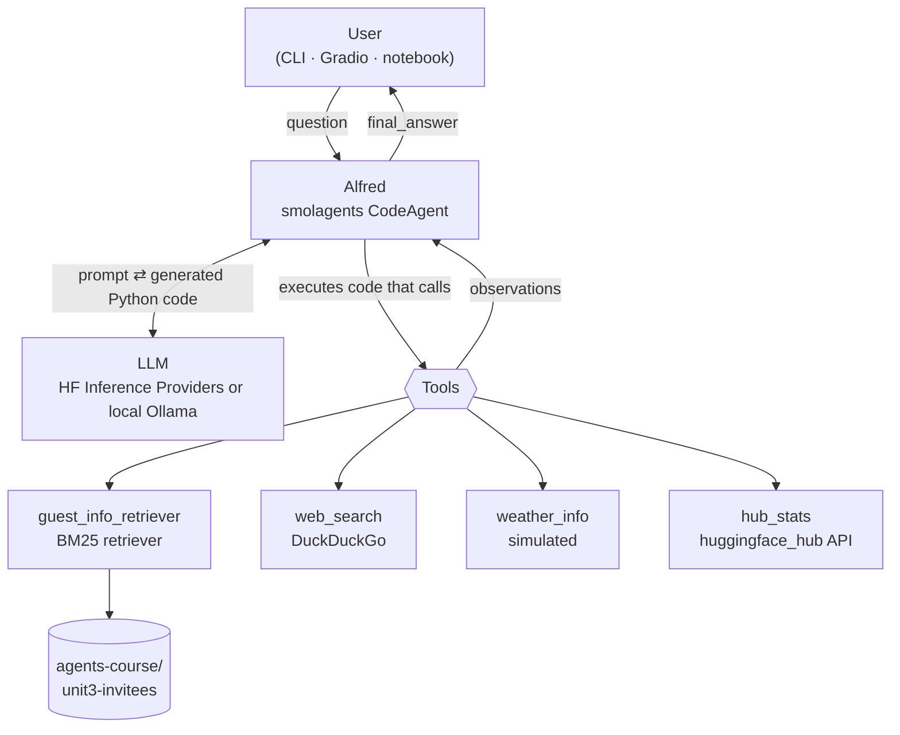

# 🎩 Alfred, the Gala Agent

An **agentic RAG** assistant built with [smolagents](https://github.com/huggingface/smolagents). It follows [Hugging Face Agents Course, Unit 3](https://huggingface.co/learn/agents-course/unit3/agentic-rag/introduction).

Alfred is the butler running an extravagant gala. He answers questions by deciding for himself which tools to use:

- **guest_info_retriever**: searches the *private* guest list (the RAG part).
- **web_search**: finds current public news through DuckDuckGo.
- **weather_info**: returns simulated weather, for planning the fireworks.
- **hub_stats**: finds an organization's most downloaded model on the Hugging Face Hub.

Unlike classic RAG, which always retrieves once and then answers, Alfred is an *agent*. He chooses whether to retrieve, which source to use, and how to combine several tools before answering.

## Architecture



**How the pieces fit together:**

1. **The CodeAgent loop** ([agent.py](agent.py)). On each step the LLM sees the question, the tool descriptions and the earlier observations. It replies with a short *thought* and a block of **Python code**. smolagents runs that code in a sandboxed local interpreter, where each tool is an ordinary Python function. Whatever the code prints becomes the next observation. The loop ends when the code calls `final_answer(...)`, or after 8 steps.
   - Because tool calls are code, Alfred can call several tools in one step, loop over results, or pass one tool's output into another.
2. **The RAG retriever** ([retriever.py](retriever.py)). It loads the guest list dataset, which has 3 guests with `name`, `relation`, `description` and `email`. Each guest's fields are combined into one text document, and the documents are indexed with **BM25** keyword ranking via `rank_bm25`. BM25 needs no embedding model and suits short documents about named people. The tool returns the top-matching guest documents.
3. **External tools** ([tools.py](tools.py)). Each one is a `smolagents.Tool` subclass with a `name`, a `description`, typed `inputs` and a `forward()` method. The LLM reads the description to decide when to use the tool.
   - The web search tool wraps smolagents' `DuckDuckGoSearchTool`, so rate limits come back as a message instead of crashing the run.
4. **The model backend** (`build_model()` in [agent.py](agent.py)). By default it uses `InferenceClientModel`, which calls Hugging Face Inference Providers with `HF_TOKEN`. Setting `ALFRED_BACKEND=ollama` switches to `OpenAIModel` pointed at a local [Ollama](https://ollama.com) server. That option is free and works offline.

## Project layout

| File | Purpose |
|---|---|
| `retriever.py` | Loads the dataset, builds the guest documents and the BM25 `guest_info_retriever` tool |
| `tools.py` | The `web_search`, `weather_info` and `hub_stats` tools |
| `agent.py` | `build_alfred()` / `build_model()`; also a command-line entry point |
| `app.py` | Gradio chat UI (`smolagents.GradioUI`) |
| `notebook.ipynb` | Step-by-step walkthrough of each tool and the full agent |

## Setup

These instructions use Python 3.12 or newer on Windows PowerShell. On macOS or Linux, activate the venv with `source .venv/bin/activate`.

```powershell
git clone https://github.com/<you>/alfred-gala-agent.git
cd alfred-gala-agent
python -m venv .venv
.\.venv\Scripts\Activate.ps1
pip install -r requirements.txt
copy .env.example .env      # then edit .env
```

Then choose a model backend in `.env`:

**Option A: Hugging Face Inference Providers** (`ALFRED_BACKEND=hf`, the default)
- Set `HF_TOKEN` to a token from https://huggingface.co/settings/tokens that has the "Make calls to Inference Providers" permission.
- These calls use your HF credits. Free accounts get a small monthly amount; PRO or prepaid credits give more.
- The default model is `Qwen/Qwen3-Coder-30B-A3B-Instruct`. The course's `Qwen2.5-Coder-32B-Instruct` is no longer served by any provider.

**Option B: local model with Ollama** (`ALFRED_BACKEND=ollama`, free)
```powershell
winget install Ollama.Ollama          # or download it from https://ollama.com/download
ollama pull qwen2.5-coder:7b          # about 4.7 GB; fits in 8 GB of VRAM
```
`HF_TOKEN` is still useful in this mode, because it gives faster and less rate-limited dataset downloads.

## Running

```powershell
# One question from the command line (it also prints which tools were used)
python agent.py "Tell me about our guest named Lady Ada Lovelace."

# Chat UI at http://127.0.0.1:7860
python app.py

# Walkthrough
jupyter notebook notebook.ipynb   # or open it in VS Code and pick the .venv kernel
```

You can also test each tool without any model:

```powershell
python retriever.py
python -c "from tools import HubStatsTool; print(HubStatsTool()('Qwen'))"
```

## Example queries

These are real runs of `python agent.py "<query>"` from 14 October 2026, using the local backend (`ALFRED_BACKEND=ollama`, `qwen2.5-coder:7b`). All four queries called the expected tools without any failed steps. Answers will vary between runs because the model is not deterministic.

### 1. Guest lookup (RAG)

> Tell me about our guest named Lady Ada Lovelace.

Alfred's code: `guest_info_retriever(query="Lady Ada Lovelace")`, which returned:

```text
Name: Ada Lovelace
Relation: best friend
Description: Lady Ada Lovelace is my best friend. She is an esteemed mathematician and friend. She is renowned for her pioneering work in mathematics and computing, often celebrated as the first computer programmer due to her work on Charles Babbage's Analytical Engine.
Email: ada.lovelace@example.com
```

**Alfred** (2 steps): *Madam Ada Lovelace was a renowned and esteemed mathematician. She was a key figure in early computing, and is celebrated as the first computer programmer.*

**Tools used:** `guest_info_retriever`

### 2. Weather

> What's the weather like in Paris tonight? Will it be suitable for our fireworks display?

Alfred's code: `weather_info(location="Paris")`, which returned:

```text
Simulated weather in Paris: Windy, 15°C, wind strong winds, 45 km/h. (Dummy data, not a real forecast.)
```

**Alfred** (2 steps): *The weather in Paris tonight is unsuitable for the fireworks display due to strong winds. We recommend rescheduling.*

**Tools used:** `weather_info`

### 3. Hugging Face Hub stats

> One of our guests is from Qwen. What can you tell me about their most popular model?

Alfred's code: `hub_stats(author="Qwen")`, which returned:

```text
The most downloaded model by Qwen is Qwen/Qwen3-0.6B with 30,452,693 downloads.
```

**Alfred** (2 steps): *Qwen's most popular model is Qwen3-0.6B, with 30,452,693 downloads.*

**Tools used:** `hub_stats`

### 4. Private guest info combined with public web search

> I need to speak with Dr. Nikola Tesla about recent advancements in wireless energy. Can you help me prepare for this conversation?

In its first step, Alfred called both tools in the same block of code: `web_search(query="latest wireless energy research")` and `guest_info_retriever(query="Nikola Tesla")`.
- The search returned live results, including a Nature review on wireless energy conversion, ScienceDirect surveys of wireless power transfer, and a ScienceDaily article on laser-powered wireless.
- The retriever returned Tesla's private record: *"old friend from university days … recently patented a new wireless energy transmission system … passionate about pigeons, so that might make for good small talk."*

**Alfred** (5 steps) answered with a Python dict of talking points, trimmed here:

```text
{'latest_findings': 'Dr. Tesla, the key findings include significant improvements in transmission efficiency, scalable wireless networks using advanced antennas, and more efficient RF harvesting. ...',
 'future_of_networks': 'Dr. Tesla, in the future, wireless energy networks are expected to revolutionize our world. ...',
 'transformative_advancements': 'Dr. Tesla, the most transformative advancement is likely the breakthrough in wireless technology that uses light instead of radio waves. ...',
 'environmental_impact': 'Dr. Tesla, the impact of wireless energy on the environment is highly positive. ...'}
```

**Tools used:** `guest_info_retriever`, `web_search`

This answer shows the limits of a 7B model. It combined the web results into talking points, but it returned a raw dict and left out the useful private details (Tesla's new patent and the pigeon small talk). A larger model through the `hf` backend usually writes a cleaner briefing.

## Notes and limitations

- **Simulated weather.** `weather_info` uses no real API. The condition is picked from a hash of the location name, so a given city always gets the same "forecast".
- **DuckDuckGo rate limits.** Search can occasionally be rate-limited or return nothing. The tool reports this to the agent instead of crashing, and the agent can rephrase or answer from its other tools. No rate limits occurred in the test runs above. If one hits you, just run the query again.
- **The model matters.** Larger models (30B and up) chain tools more reliably than 7B local models. Change the model with `ALFRED_MODEL_ID` in `.env`.
- **Prompting small models.** In early test runs, `qwen2.5-coder:7b` guessed wrong argument names (`guest_info_retriever(name=...)`). It also tried to index the retriever's text output as if it were a dict. To prevent this, `ALFRED_INSTRUCTIONS` in `agent.py` now lists each tool's exact call signature and says that every tool returns a plain string. The `Tools used` line counts only steps that ran without an error, so a failed tool call is not counted as a pass.
- **Code execution.** Code runs in smolagents' local Python interpreter, which only allows a fixed list of imports. That is fine for a demo; for anything untrusted, use smolagents' remote executors (E2B, Docker, Modal).
